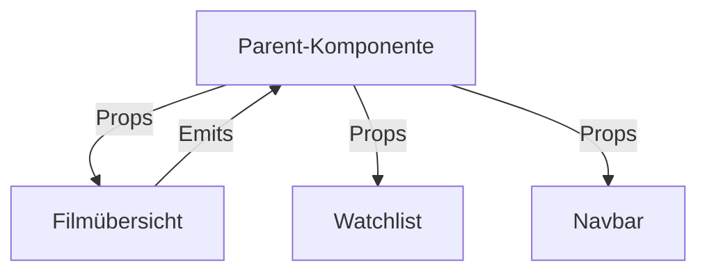
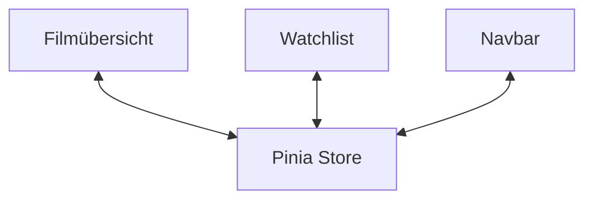

---
theme: seriph
title: Pinia – State Management für Vue.js
transition: slide-left
duration: 20min
---

# Pinia 🍍

## State Management für Vue.js

Komponentenbasierte Entwicklung  
HTW Berlin · Wintersemester 2026/27

---

# Ein Problem aus der Praxis

Stell dir eine Anwendung mit drei Komponenten vor:

- **Filmübersicht:** Fügt Filme zur Watchlist hinzu
- **Watchlist:** Zeigt gespeicherte Filme an
- **Navbar:** Zeigt die Anzahl gespeicherter Filme

<v-click>

### Die zentrale Frage

Wie können alle drei Komponenten auf dieselben Daten zugreifen, ohne diese mehrfach zu verwalten?

</v-click>

---

# Wie funktioniert das ohne Pinia?

<v-click>

**Herausforderung:** Bei einer tief verschachtelten Komponentenstruktur kann die Datenweitergabe kompliziert werden.

</v-click>

---

# Die Lösung: Pinia

Pinia ermöglicht die zentrale Verwaltung eines gemeinsam genutzten Anwendungszustands.

<v-click>

**Vorteil:** Komponenten können direkt auf den gemeinsamen Store zugreifen.

</v-click>

---

# Drei Kernkonzepte

### State
Speichert die Daten der Anwendung.

### Getters
Berechnen abgeleitete Werte aus dem State.

### Actions
Enthalten Logik und können den State verändern.

---
