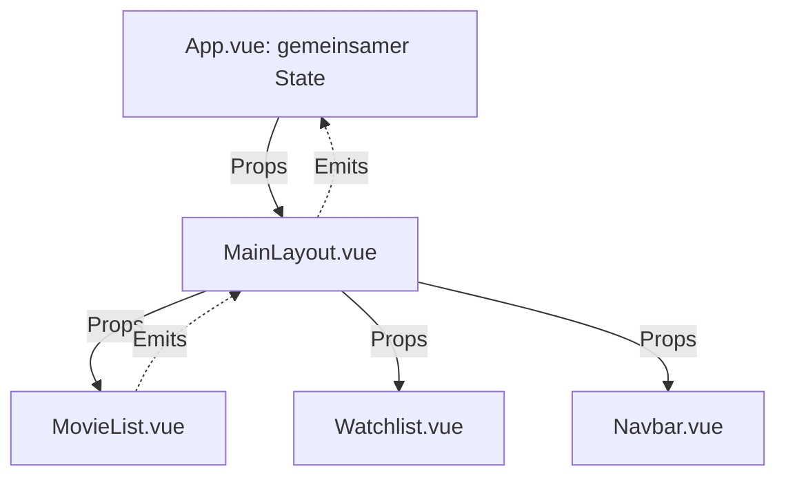
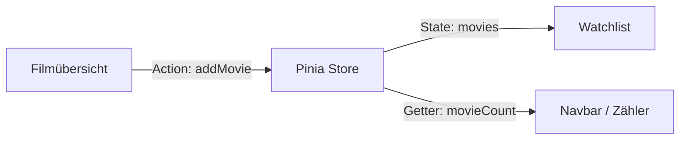

# Pinia 🍍

## State Management für Vue.js

**Offizielle State-Management-Bibliothek für Vue.js**

Ein gemeinsamer Zustand – mehrere unabhängige Komponenten

<div class="mt-10 text-sm opacity-70">
Komponentenbasierte Entwicklung · HTW Berlin · Wintersemester 2026/27
</div>

<!--
THEORIE · 0:00–0:35 (35 Sekunden)
Einstieg: Vue zerlegt Benutzeroberflächen in Komponenten. Schwieriger wird es,
wenn mehrere Komponenten dieselben Daten benötigen. Pinia ist die offizielle
State-Management-Lösung im Vue-Ökosystem. Leitfrage: Wie teilen Komponenten
Zustände zuverlässig, ohne lange Übergabeketten aufzubauen?
-->

---

# Ein Problem aus der Praxis

### Unsere Beispielanwendung: Pick My Movie

<div class="grid grid-cols-3 gap-5 mt-10">
  <div class="p-5 rounded-xl bg-yellow-500/15">
    <div class="text-2xl mb-3">🎬</div>
    <h3>Filmübersicht</h3>
    <p class="text-sm">Fügt einen Film zur Watchlist hinzu.</p>
  </div>
  <div class="p-5 rounded-xl bg-green-500/15">
    <div class="text-2xl mb-3">🔖</div>
    <h3>Watchlist</h3>
    <p class="text-sm">Zeigt die gespeicherten Filme an.</p>
  </div>
  <div class="p-5 rounded-xl bg-blue-500/15">
    <div class="text-2xl mb-3">🔢</div>
    <h3>Filmzähler</h3>
    <p class="text-sm">Zeigt die aktuelle Anzahl an.</p>
  </div>
</div>

<v-click>
<div class="mt-8 text-lg font-semibold">
Wie bleiben diese drei Komponenten auf demselben Stand?
</div>
</v-click>

<!--
THEORIE · 0:35–1:25 (50 Sekunden)
Ein Zuschauer fügt Interstellar hinzu. Dann muss der Film zugleich in der
Watchlist auftauchen und der Zähler von null auf eins springen. Alle drei
Bausteine benötigen Informationen über dieselben Filme. Hier sprechen wir
von gemeinsam genutztem Anwendungszustand (Shared State).
-->

---

# Komponentenkommunikation ohne Pinia

<div class="text-sm opacity-75 mb-3">Vue kann mit <b>Props</b> (Daten nach unten) und <b>Emits</b> (Ereignisse nach oben) kommunizieren.</div>



<v-click>
<div class="mt-4 p-3 rounded-lg bg-yellow-500/15 text-sm">
<b>Prop Drilling:</b> Daten werden über Zwischenkomponenten weitergereicht, die sie selbst nicht benötigen.
</div>
</v-click>

<!--
THEORIE · 1:25–2:20 (55 Sekunden)
Props: Parent gibt Werte an Child. Emits: Child meldet ein Ereignis,
zum Beispiel addMovie, an den Parent. Der Parent kann den State ändern.
Das ist für kleine Anwendungen richtig und ausreichend. Bei tiefen
Komponentenbäumen ist es jedoch mühsam, Werte und Ereignisse über
mehrere Ebenen durchzureichen. Dieses Weiterreichen nennt man Prop Drilling.
Pinia ersetzt Props/Emits nicht grundsätzlich; es ergänzt sie.
-->

---

# Die Lösung: Ein zentraler Pinia-Store



<v-click>
<div class="mt-7 text-lg font-semibold text-center">
Komponenten greifen direkt auf <span class="text-green-500">denselben reaktiven Store</span> zu.
</div>
</v-click>

<div class="mt-5 text-sm opacity-75 text-center">
Pinia verwaltet gemeinsam genutzte Daten <b>außerhalb</b> einzelner Vue-Komponenten.
</div>

<!--
THEORIE · 2:20–3:00 (40 Sekunden)
Ein Store ist eine Einheit für gemeinsamen Zustand und die passende Logik.
MovieList löst eine Action aus, Watchlist liest den State, der Zähler nutzt
einen Getter. Alle bekommen dieselbe Store-Instanz innerhalb der Vue-App.
Pinia selbst speichert nicht automatisch auf einem Backend oder dauerhaft
im Browser; es verwaltet zuerst einmal den reaktiven Client-Zustand.
-->

---

# Die drei Kernkonzepte

<div class="grid grid-cols-3 gap-5 mt-10">
  <div class="p-5 rounded-xl bg-yellow-500/15">
    <div class="text-2xl mb-2">📦</div>
    <h3>State</h3>
    <p class="text-sm">Die reaktiven Daten des Stores.</p>
    <div class="mt-5 font-mono text-sm">movies: []</div>
  </div>
  <div class="p-5 rounded-xl bg-green-500/15">
    <div class="text-2xl mb-2">🧮</div>
    <h3>Getters</h3>
    <p class="text-sm">Berechnete Werte aus dem State.</p>
    <div class="mt-5 font-mono text-sm">movieCount</div>
  </div>
  <div class="p-5 rounded-xl bg-blue-500/15">
    <div class="text-2xl mb-2">⚡</div>
    <h3>Actions</h3>
    <p class="text-sm">Methoden für Logik und Änderungen.</p>
    <div class="mt-5 font-mono text-sm">addMovie()</div>
  </div>
</div>

<div class="mt-8 text-center text-sm opacity-70">
Entspricht ungefähr <b>data</b>, <b>computed</b> und <b>methods</b> in Vue.
</div>

<!--
THEORIE · 3:00–4:00 (60 Sekunden)
State ist der Zustand: Welche Filme sind gespeichert? Getters lesen
und berechnen abgeleitete Daten: Wie viele Filme gibt es? Actions
enthalten Methoden zum Hinzufügen, Entfernen oder asynchronen Laden.
Der Getter speichert nicht nochmals separat die Anzahl, sondern berechnet
sie aus movies. Dadurch vermeiden wir doppelte, inkonsistente Daten.
-->

---

# Der Pinia-Store: `watchlist.js`

<div class="text-xs opacity-65">Auszug aus dem Option Store – die asynchrone Action sehen wir später.</div>

```js {all|3|4-7|9-11|13-21|all}{lines:true}
import { defineStore } from 'pinia'

export const useWatchlistStore = defineStore('watchlist', {
  state: () => ({
    movies: [],
    loading: false
  }),

  getters: {
    movieCount: state => state.movies.length
  },

  actions: {
    addMovie(movie) {
      if (!this.movies.some(m => m.id === movie.id)) {
        this.movies.push(movie)
      }
    },
    removeMovie(id) {
      this.movies = this.movies.filter(m => m.id !== id)
    }
  }
})
```

<!--
THEORIE · 4:00–5:25 (85 Sekunden)
Schrittweise markieren: defineStore('watchlist') gibt dem Store eine ID.
state ist eine Funktion, die Anfangswerte zurückgibt; loading ist zunächst
false. Der Getter movieCount berechnet movies.length. Die Action addMovie
prüft die ID, um Duplikate zu verhindern, und nutzt this.movies.push.
removeMovie filtert den Film heraus. Die ausführliche Originaldatei hat
zusätzlich loadRecommendation(). Ein solcher Stil heißt Option Store.
-->

---

# Pinia vs. VueUse vs. Vue I18n

<div class="grid grid-cols-3 gap-4 mt-7">
  <div class="p-4 rounded-xl bg-yellow-500/15">
    <h3>🍍 Pinia</h3>
    <p class="font-semibold text-sm">State Management</p>
    <p class="text-sm">Stores, Getters, Actions</p>
    <p class="mt-4 text-sm"><b>Beispiel:</b> Watchlist</p>
  </div>
  <div class="p-4 rounded-xl bg-green-500/15">
    <h3>🛠️ VueUse</h3>
    <p class="font-semibold text-sm">Reaktive Utilities</p>
    <p class="text-sm">Composables, Browser-APIs</p>
    <p class="mt-4 text-sm"><b>Beispiel:</b> useLocalStorage()</p>
  </div>
  <div class="p-4 rounded-xl bg-blue-500/15">
    <h3>🌍 Vue I18n</h3>
    <p class="font-semibold text-sm">Internationalisierung</p>
    <p class="text-sm">Übersetzungen, Sprachwechsel</p>
    <p class="mt-4 text-sm"><b>Beispiel:</b> DE / EN</p>
  </div>
</div>

<div class="mt-6 p-3 rounded-lg bg-gray-500/10 text-sm">
<b>Wann Pinia?</b> Wenn mehrere Komponenten gemeinsamen Zustand benötigen – z. B. Watchlist oder Warenkorb.
<br>
<b>Grenze:</b> Für den Zustand eines einzelnen Dropdowns ist ein eigener Store meist unnötig.
</div>

<div class="mt-3 text-xs opacity-65">Die Bibliotheken ergänzen sich; VueUse kann ebenfalls reaktiven State teilen.</div>

<!--
THEORIE · 5:25–6:20 (55 Sekunden)
Die Bibliotheken sind keine unmittelbaren Konkurrenten. Pinia organisiert
geteilte Anwendungsdaten in Stores. VueUse bietet viele wiederverwendbare
Composables, etwa useLocalStorage; es kann ebenfalls State teilen.
Vue I18n ist für Übersetzungen, Sprachen und Lokalisierung zuständig.
Pinia ist dann passend, wenn mehrere Komponenten denselben Zustand
zuverlässig nutzen. Bei rein lokalem UI-Zustand wäre es Overengineering.
-->

---
layout: two-cols-header
transition: slide-left
---

# Wie greifen Vue-Komponenten auf den Store zu?

::left::

### `MovieList.vue` · Action auslösen

```vue {all|2-3|9-11|all}{at:1}{lines:true}
<script setup>
import { useWatchlistStore } from '../stores/watchlist'
const store = useWatchlistStore()
const movies = [{ id: 1, title: 'Interstellar' }]
</script>

<template>
  <button v-for="movie in movies" :key="movie.id"
    @click="store.addMovie(movie)">
    Hinzufügen
  </button>
</template>
```

::right::

### `WatchlistCounter.vue` · Getter lesen

```vue {all|2-3|7-8|all}{at:1}{lines:true}
<script setup>
import { useWatchlistStore } from '../stores/watchlist'
const store = useWatchlistStore()
</script>

<template>
  <p>Gespeicherte Filme:
    {{ store.movieCount }}</p>
</template>
```

<div class="mt-6 text-sm font-semibold">Ein Store – mehrere Komponenten.</div>

<!--
THEORIE · 6:20–7:25 (65 Sekunden)
Beide Komponenten importieren dieselbe Funktion useWatchlistStore().
Links ruft ein Button addMovie(movie) auf; movie kommt aus v-for.
Rechts liest der Zähler store.movieCount direkt im Template.
Wichtig: Komponenten müssen einander weder direkt kennen noch Props
weiterreichen. Beide reagieren auf denselben Store. Das ist gekürzter Code,
keine komplette Kopie aller Demo-Dateien.
-->

---
layout: two-cols-header
transition: slide-left
---

# Zwei nützliche Pinia-Funktionen

::left::

### `storeToRefs()` · Reaktivität behalten

```js {all|1|3-4|all}{at:1}{lines:true}
import { storeToRefs } from 'pinia'

const store = useWatchlistStore()
const { movies, movieCount } = storeToRefs(store)
```

<div class="mt-4 text-sm">
<b>Warum?</b> Normale Destrukturierung kann die reaktive Verbindung zu State/Getters verlieren.
</div>

<div class="mt-3 text-xs opacity-70">
Im JavaScript: <code>movieCount.value</code> · Im Template wird das Ref automatisch entpackt.
</div>

::right::

### `$reset()` · Anfangszustand wiederherstellen

```js {all|1|3|all}{at:1}{lines:true}
const store = useWatchlistStore()

store.$reset()
```

<div class="mt-4 text-sm">
<b>Ergebnis bei unserem Option Store:</b>
</div>

```js
movies: []
loading: false
```

<div class="mt-3 text-xs opacity-70">Bei Setup Stores muss die Reset-Logik selbst implementiert werden.</div>

<!--
THEORIE · 7:25–8:20 (55 Sekunden)
Direkter Zugriff auf store.movieCount funktioniert schon reaktiv.
Wenn wir Variablen jedoch aus dem Store herauslösen möchten, brauchen
wir storeToRefs für State und Getters. Aktionen bleiben Methoden des Stores.
$reset stellt beim Option Store die Werte wieder her, die state() initial
liefert: leere Filmliste, loading false. Wir zeigen gleich den Reset-Button.
-->

---

# Asynchrone Actions: Eine Empfehlung laden

<div class="text-xs opacity-70">Auszug aus <code>watchlist.js</code> · bewusst ohne externe API, damit die Demo offline funktioniert.</div>

```js {all|1-3|5|7-8|9-11|all}{lines:true}
async loadRecommendation() {
  if (this.loading) return
  this.loading = true

  try {
    // Simulierte Wartezeit – keine echte HTTP-Anfrage
    await new Promise(resolve => setTimeout(resolve, 1500))
    this.addMovie({ id: 5, title: 'The Matrix', year: 1999 })
  } finally {
    this.loading = false
  }
}
```

<div class="mt-4 grid grid-cols-3 gap-3 text-sm text-center">
  <div class="p-2 rounded-lg bg-yellow-500/15">1 · loading = true</div>
  <div class="p-2 rounded-lg bg-blue-500/15">2 · await ...</div>
  <div class="p-2 rounded-lg bg-green-500/15">3 · State aktualisiert</div>
</div>

<!--
THEORIE · 8:20–9:30 (70 Sekunden)
Eine Action darf async sein. In einer echten Anwendung könnte darin
fetch('/api/...') stehen. Hier erzeugt ein Promise eine Verzögerung von
1,5 Sekunden: Das simuliert eine asynchrone Antwort, ruft aber KEINE API
auf. loading wird true, dann fügen wir The Matrix hinzu. finally stellt
loading auch im Fehlerfall wieder auf false. Die Vue-Anzeige reagiert
währenddessen auf loading und anschließend auf die Filmliste.
Beachte: Allgemeine Fehlerbehandlung müsste man produktiv ergänzen.
-->

---

# Von der Theorie zur Praxis

### Was beobachten wir in der Live-Demo?

<div class="grid grid-cols-2 gap-4 mt-8 text-sm">
  <div class="p-4 rounded-xl bg-yellow-500/15"><b>1.</b> Action auslösen & Film hinzufügen</div>
  <div class="p-4 rounded-xl bg-green-500/15"><b>2.</b> Reaktivität & Getter beobachten</div>
  <div class="p-4 rounded-xl bg-blue-500/15"><b>3.</b> Store-State live inspizieren</div>
  <div class="p-4 rounded-xl bg-purple-500/15"><b>4.</b> $reset() und Async Action testen</div>
</div>

<div class="mt-7 text-sm opacity-75">
<b>Debugging:</b> Unser eingebauter Inspector zeigt <code>store.$state</code> und Getters. Die offiziellen <b>Vue Devtools</b> bieten darüber hinaus Werkzeuge zur Store-Inspektion.
</div>

<!--
THEORIE · 9:30–10:00 (30 Sekunden)
Jetzt testen wir genau die Konzepte aus dem Vortrag. Unser selbstgebauter
Store-Inspector visualisiert Live-Werte und ist NICHT identisch mit den Vue
Devtools. Letztere kann man optional ergänzend öffnen, sofern sie in der
vorbereiteten Präsentationsumgebung vorher getestet wurden. Danach direkt
auf die nächste Folie mit der interaktiven Watchlist wechseln.
-->

---
layout: default
transition: slide-left
---

# Live-Demo: Pinia in Aktion

<WatchlistDemo />

<!--
LIVE-DEMO · 10:00–15:00 (5 Minuten)
0:00–1:00 EXPERIMENT 1 – Publikum wählt einen Film; auf Hinzufügen klicken.
Erklären: MovieList ruft store.addMovie(movie) auf. Diese Action ändert movies.
1:00–2:00 EXPERIMENT 2 – Watchlist und Filmzähler zeigen. Erklären:
Die Watchlist liest den State, movieCount berechnet movies.length.
2:00–3:10 EXPERIMENT 3 – Eingebauten Store-Inspector öffnen/zeigen.
Nach einer weiteren Aktion beobachten: store.$state und Getter.
Optional Vue Devtools nur öffnen, wenn vorher getestet und verfügbar.
3:10–4:00 EXPERIMENT 4 – Vorhersagefrage ans Publikum: Was macht $reset()?
Reset klicken; Liste leer, movieCount gleich null, loading false.
4:00–5:00 EXPERIMENT 5 – Filmempfehlung laden. loading wird true,
1,5 Sekunden warten; The Matrix erscheint, loading wird wieder false.
Abschluss: Eine Action ändert den gemeinsamen State, mehrere Komponenten
reagieren darauf. Falls die Zeit knapp wird: Experiment 3 kürzen.
-->

---
layout: center
class: text-center
transition: fade
---

# 🍍 Fazit: Pinia in Aktion

<div class="grid grid-cols-2 gap-5 mt-8 text-left">
  <div class="p-5 rounded-xl bg-yellow-500/15">
    <h3>📦 State</h3>
    <p class="text-sm">Die gespeicherten Filme und der Loading-Status.</p>
  </div>
  <div class="p-5 rounded-xl bg-green-500/15">
    <h3>🧮 Getters</h3>
    <p class="text-sm">Berechnen die Anzahl der Filme.</p>
  </div>
  <div class="p-5 rounded-xl bg-blue-500/15">
    <h3>⚡ Actions</h3>
    <p class="text-sm">Hinzufügen, Entfernen, Laden.</p>
  </div>
  <div class="p-5 rounded-xl bg-purple-500/15">
    <h3>🔄 Reaktivität</h3>
    <p class="text-sm">Abhängige Komponenten aktualisieren sich.</p>
  </div>
</div>

<div class="mt-8 text-xl font-semibold">Ein gemeinsamer Store – mehrere synchronisierte Komponenten.</div>

<div class="mt-6 opacity-70">Fragen?</div>

<!--
FAZIT / DISKUSSION · ab 15:00
Kernaussage in 15–20 Sekunden wiederholen, dann zu den fünf Minuten
Diskussion übergehen. Mögliche Rückfragen: Warum reicht ref() nicht aus?
Warum ist storeToRefs hilfreich? Braucht man für jeden State Pinia?
Speichert Pinia Daten dauerhaft? Ist der Inspector Vue Devtools?
-->

---
layout: default
---

# Quellen und weiterführende Dokumentation

**Offizielle Dokumentation:**

- [Pinia – Defining a Store](https://pinia.vuejs.org/core-concepts/)
- [Pinia – State und $reset()](https://pinia.vuejs.org/core-concepts/state.html)
- [Pinia – Actions und asynchrone Actions](https://pinia.vuejs.org/core-concepts/actions.html)
- [Pinia – Store-Dekonstruktion / storeToRefs](https://pinia.vuejs.org/core-concepts/#destructuring-from-a-store)
- [VueUse – Guide](https://vueuse.org/guide/)
- [Vue I18n – Introduction](https://vue-i18n.intlify.dev/guide/introduction)
- [Slidev – Syntax und Presenter-Notizen](https://sli.dev/guide/syntax)

<div class="mt-7 text-sm opacity-65">Anhang – nicht Teil der 10-minütigen Theorie und der 5-minütigen Live-Demo.</div>

<!--
QUELLENFOLIE · ANHANG
Nur bei Nachfrage anzeigen oder zur Dokumentation in der PDF/PPTX lassen.
Die Präsentation endet inhaltlich auf der vorherigen Fazit-Folie.
-->

---
layout: center
transition: fade
---

<PiniaIcon style="width: 275px; height: 350px" />